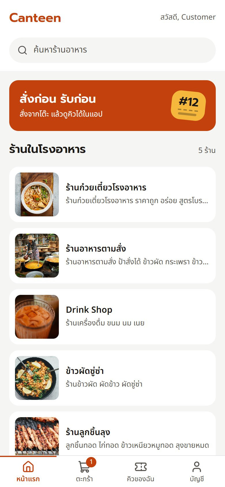
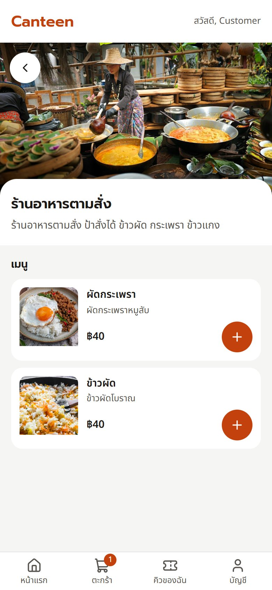
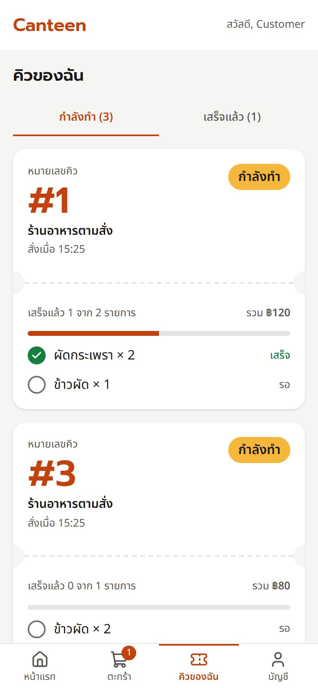
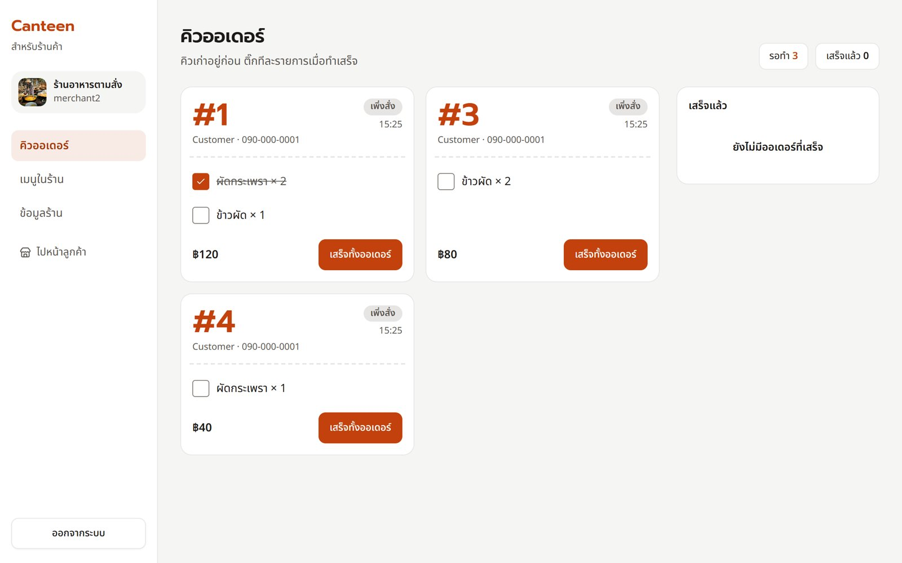

# Canteen 🍜

[](https://github.com/aumputthipong/FoodOrderingProject/actions/workflows/ci.yml)


ระบบสั่งอาหารในโรงอาหาร ลูกค้าสั่งจากโต๊ะผ่านมือถือแล้วดูคิวของตัวเองได้ ส่วนแม่ค้าดูคิวและติ๊กรายการที่ทำเสร็จจากหน้าจอที่ร้าน

เดิมเป็นโปรเจกต์วิชา Web Programming ตอนปี 2 (Vue 2 + Express + MySQL) แล้วนำมา **rebuild ใหม่ทั้งระบบ** เป็น TypeScript monorepo ที่มี test, type, CI และ Docker
- โค้ดเดิมเก็บไว้ในประวัติ git ก่อน [PR #1](https://github.com/aumputthipong/FoodOrderingProject/pull/1)

> 🚧 **สถานะ:** เฟส 1–2.5 เสร็จแล้ว ได้แก่ backend, frontend ใหม่ และการเกลา UX/UI
> ถัดไปคือคิวแบบ realtime (Socket.IO) แล้วตามด้วย deploy live demo (ดู [Roadmap](#roadmap))

---

## Screenshots

<table>
  <tr>
    <td align="center"><br/>หน้าแรก</td>
    <td align="center"><br/>หน้าร้าน + เมนู</td>
    <td align="center"><br/>บัตรคิวของฉัน</td>
  </tr>
  <tr>
    <td colspan="3" align="center"><br/>หน้าจัดการคิวของแม่ค้า (คอม/แท็บเล็ต)</td>
  </tr>
</table>

---

## ลองใช้งาน

ยังไม่มี live demo ตอนนี้รันในเครื่องได้ด้วยคำสั่งเดียว (ต้องมี Docker):

```bash
docker compose up --build
```

เปิด http://localhost:8080 แล้วใช้บัญชีทดลองได้เลย ไม่ต้องสมัครใหม่

| บทบาท | Username | Password |
|---|---|---|
| ลูกค้า | `customer1` | `Password123` |
| แม่ค้า (ร้านที่ 1–5) | `merchant1` – `merchant5` | `Password123` |

**ลองแบบนี้:** เปิด 2 หน้าต่างคู่กัน (หน้าหนึ่งเป็น private window)
1. ล็อกอิน `customer1` แล้วเลือกเมนูจาก "ร้านอาหารตามสั่ง" แล้วกดสั่ง
2. อีกหน้าต่างล็อกอิน `merchant2` เปิดหน้าคิวออเดอร์ แล้วติ๊กรายการว่าทำเสร็จ หรือกด "เสร็จทั้งออเดอร์"
3. กลับไปที่หน้า "คิวของฉัน" ของลูกค้า บัตรคิวจะอัปเดตความคืบหน้าเองภายใน 15 วินาที (polling) และเปลี่ยนเป็น "✓ พร้อมรับที่ร้าน" เมื่อเสร็จ

API docs (Swagger UI) ดูได้ที่ http://localhost:3000/api/docs

---

## Tech Stack

| ส่วน | เลือกใช้ | หน้าที่ในระบบ |
|---|---|---|
| Monorepo | pnpm workspaces | แยก `apps/api`, `apps/web`, `packages/shared` แต่ใช้ type และ schema ร่วมกัน |
| Contract | Zod (`@canteen/shared`) | schema ชุดเดียวใช้ตรวจ request ฝั่ง API, สร้าง OpenAPI docs, เป็น type ของ response และตรวจฟอร์มฝั่งเว็บ |
| Backend | Express 5 + TypeScript | แบ่งตามฟีเจอร์ (`modules/*`) แต่ละ module เป็น routes → controller → service → repository |
| Database | MySQL 8.4 + Drizzle ORM | schema และ migration อยู่ใน git, transaction ของตะกร้าและการสั่งรองรับการกดพร้อมกัน |
| Frontend | Vue 3 (`<script setup>`) + Vite + Vue Router | แบ่งตามฟีเจอร์ (`features/*`) เหมือนฝั่ง API |
| Server state | TanStack Vue Query | cache, loading/error, invalidate หลังแก้ข้อมูล, optimistic update, polling คิว |
| Client state | Pinia | เก็บแค่ session ของผู้ใช้ (store `auth`) |
| UI | Tailwind CSS 4 + shadcn-vue | design token สีส้มพริก ฟอนต์ Prompt + Noto Sans Thai, component ที่ปรับให้ผ่าน WCAG AA |
| Forms | vee-validate + Zod adapter | ใช้ schema เดียวกับ API และแปลข้อความ validation เป็นภาษาไทย |
| Test | Vitest, supertest, Vue Test Utils, MSW | API test กับ MySQL จริง, web test จำลอง API ที่ระดับ network (รวม 400+ tests) |
| Infra | Docker Compose, nginx, GitHub Actions | รันทั้งระบบคำสั่งเดียว, CI รัน lint / typecheck / test / build ทุก push |

---

## โครงหน้าจอ

```
ลูกค้า (มือถือก่อน)                          แม่ค้า (คอม/แท็บเล็ตก่อน)
┌────────────────────────────┐            ┌──────────┬──────────────────────────┐
│ Canteen          [ค้นหา]    │            │ Canteen  │  คิวออเดอร์    รอทำ 3       │
├────────────────────────────┤            │ ร้านของฉัน │  ┌──────┐ ┌──────┐ ┌────┐ │
│  /           รายการร้าน     │            │          │  │ #42  │ │ #43  │ │เสร็จ│ │
│  /shops/:id  เมนู + ตะกร้า  │            │ คิวออเดอร์  │  │รอ 12น│ │เพิ่งสั่ง│ │แล้ว │ │
│  /cart       ตะกร้าแยกร้าน  │            │ เมนูในร้าน │  │ ☑ ☐  │ │ ☐    │ │    │ │
│  /orders     บัตรคิวของฉัน  │            │ ข้อมูลร้าน  │  └──────┘ └──────┘ └────┘ │
│  /account    บัญชี          │            │          │                          │
├────────────────────────────┤            │ ไปหน้าลูกค้า │  /merchant/queue          │
│ หน้าแรก · ตะกร้า · คิว · บัญชี │            │ ออกจากระบบ │  /merchant/menu(/new|/:id)│
└────────────────────────────┘            └──────────┴──  /merchant/shop(/new) ───┘
  แถบเมนูล่าง < 768px, top nav ≥ 768px        sidebar ≥ 1024px, แท็บด้านบน < 1024px
```

Router guard ตรวจสิทธิ์ตามบทบาท และพา merchant ที่ยังไม่มีร้านไป `/merchant/shop/new` ก่อน

---

## จุดที่น่าสนใจในโค้ด

- 🔹 **กด + รัวๆ แล้วตะกร้าไม่เพี้ยน**
  - ที่มาของปัญหา: API แทนที่ตะกร้าทั้งร้านในครั้งเดียว ถ้าส่งทุกครั้งที่กด request จะกลับมาสลับลำดับกันได้
  - วิธีแก้ ([`useShopCartDraft`](apps/web/src/features/cart/composables/useShopCartDraft.ts)):
    - ตัวเลขบนจอเปลี่ยนทันที
    - รอให้หยุดกด 300ms ก่อนค่อยส่ง และส่ง**ทีละ request ต่อร้าน**เสมอ
    - ไม่รับการแก้ไขจนกว่าตะกร้าเดิมจะโหลดเสร็จ กันไม่ให้ของในตะกร้าเดิมถูกเขียนทับหาย
  - test จำลอง request ที่ค้าง เพื่อพิสูจน์ว่าไม่มีวันส่งซ้อนกัน
- 🔹 **ติ๊กคิวแล้วไม่เด้งกลับ**
  - ที่มาของปัญหา: หน้าคิวของแม่ค้า refetch ทุก 15 วินาที และใช้ optimistic update ตอนติ๊ก ถ้าผล refetch เก่ากลับมาระหว่างกำลังบันทึก ติ๊กจะเด้งกลับ
  - วิธีแก้ ([`merchant/queries.ts`](apps/web/src/features/merchant/queries.ts)): ถ้าผล refetch กลับมาตอนที่ยังมีการติ๊กค้างอยู่ จะทิ้งผลรอบนั้นแล้วใช้ข้อมูลใน cache แทน
  - ใช้แทนการหยุด polling ชั่วคราว ซึ่งลองแล้วพบว่าทำให้ polling ไม่กลับมาทำงานอีก
- 🔹 **Schema ชุดเดียวใช้ได้ทั้งระบบ**
  - Zod schema ใน [`packages/shared`](packages/shared/src/schemas) ใช้ตรวจ request ฝั่ง API, สร้างเอกสาร OpenAPI, ตรวจ response ฝั่งเว็บ และเป็น schema ของฟอร์ม
  - ฝั่งเว็บมี adapter แปลงข้อผิดพลาดเป็นข้อความไทยที่คนอ่านเข้าใจ เช่น "กรุณากรอกราคา"
- 🔹 **ตะกร้าและการสั่งไม่พังเมื่อผู้ใช้กดพร้อมกัน**
  - transaction ใช้ `READ COMMITTED` และ retry อัตโนมัติเมื่อเจอ deadlock ([`db/client.ts`](apps/api/src/db/client.ts))
  - ตอน checkout ล็อกแถวที่จะแก้ไข
  - มี test ยิง request พร้อมกันหลายตัว
  - token เก็บใน DB เป็น SHA-256 เท่านั้น ไม่เก็บตัว token จริง
- 🔹 **Error ไปจัดการที่จุดเดียว**
  - `api-client` แปลงทุก error เป็น `ApiError` รูปแบบเดียวกัน แล้วแปลเป็นข้อความไทย
  - ถ้าเจอ 401 ระหว่างใช้งาน ระบบจะล้าง session และ cache ทั้งหมด แล้วพากลับไปหน้า login ที่หน้าเดิม
  - คนที่ใช้มือถือเครื่องเดียวกันต่อจะไม่เห็นตะกร้าของคนก่อน

---

## เริ่มพัฒนา

ต้องใช้ **Node ≥ 24**, pnpm (ผ่าน corepack) และ Docker

```bash
corepack enable
pnpm install
docker compose up -d db                   # MySQL ที่ port 3307
cp apps/api/.env.example apps/api/.env
pnpm db:reset                             # migrate + seed ข้อมูลตัวอย่าง
pnpm dev                                  # API :3000 และเว็บ (Vite) :5173
```

คำสั่งอื่นๆ:

```bash
pnpm test        # ต้องมี db รันอยู่ (ใช้ฐานข้อมูล canteen_test)
pnpm lint
pnpm typecheck
pnpm build
```

**หมายเหตุ**
- `docker/mysql/init.sql` ซึ่งสร้างฐานข้อมูล `canteen_test` จะรันเฉพาะตอน volume `db-data` ถูกสร้างใหม่
- seed คัดลอกรูปตัวอย่างไปที่ uploads เฉพาะรูปที่ยังไม่มี ไม่เขียนทับรูปเดิม ถ้าต้องการเริ่มใหม่ทั้งหมดให้รัน `docker compose down -v`
  - คำสั่งนี้ลบข้อมูล demo และรูปที่อัปโหลดไว้ทั้งหมด
- ถ้าต้องการแสดงกล่องบัญชีทดลองบนหน้า login ตอน build ด้วย Docker ให้ส่ง build arg `VITE_DEMO_HINT=true` ให้ service `web`
- รูปอาหารใน seed มาจาก Unsplash ดูเครดิตได้ที่ [`apps/api/seed/images/CREDITS.md`](apps/api/seed/images/CREDITS.md)

---

## Security

- **nginx (`apps/web/nginx`):**
  - ส่ง `Content-Security-Policy` (`script-src 'self'`, `frame-ancestors 'none'`), `X-Content-Type-Options: nosniff` และ `Referrer-Policy` ทุก response รวมถึงไฟล์ใน `/assets`
  - proxy `/api` และ `/uploads` ทำให้เว็บกับ API เป็น origin เดียวกัน
- **API:**
  - ใช้ `helmet` และจำกัดจำนวนครั้งที่ login ได้ (rate limit)
  - ตรวจชนิดและขนาดไฟล์รูปที่อัปโหลด
  - ใช้ bcrypt กับรหัสผ่าน
- **Web:**
  - ไม่ใช้ `v-html`
  - ค่า `?redirect=` หลัง login รับเฉพาะ path ภายในเว็บเท่านั้น
  - ตรวจ response ทุกตัวด้วย Zod
- **Trade-off ที่ตั้งใจเลือก:** token เก็บใน `localStorage` เพราะ API ออกแบบเป็น Bearer token ไว้แล้ว ถ้าย้ายไปใช้ httpOnly cookie ต้องแก้ API ด้วย

---

## Roadmap

| เฟส | งาน | สถานะ |
|---|---|---|
| 1 | Backend: monorepo, Express 5 + Drizzle, migration, test, Docker, CI, Swagger | ✅ |
| 2 | Frontend ใหม่: Vue 3 + TS + Tailwind/shadcn-vue, ดีไซน์ใหม่, ฟีเจอร์เท่าเดิม | ✅ |
| 2.5 | เกลา UX/UI: token, focus/contrast, empty states, layout บนจอคอม | ✅ |
| 3 | คิวแบบ realtime ด้วย Socket.IO, สถานะออเดอร์ `pending → preparing → ready → completed`, แจ้งเตือนแม่ค้าและลูกค้า | ⏳ |
| 4 | Deploy live demo, ภาพหน้าจอ / GIF, README ฉบับสมบูรณ์ | ⏳ |

เอกสารออกแบบและแผนของแต่ละเฟสอยู่ใน [`docs/superpowers`](docs/superpowers)
